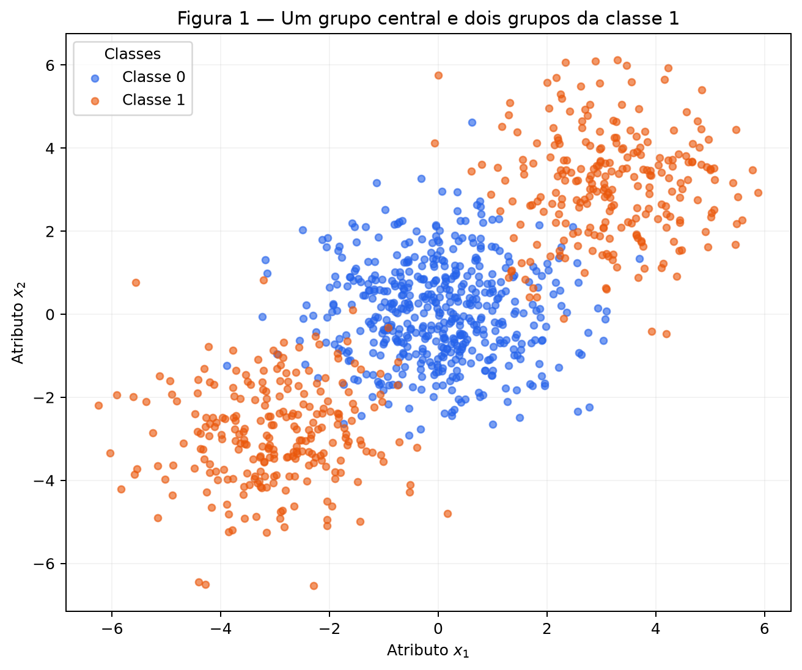
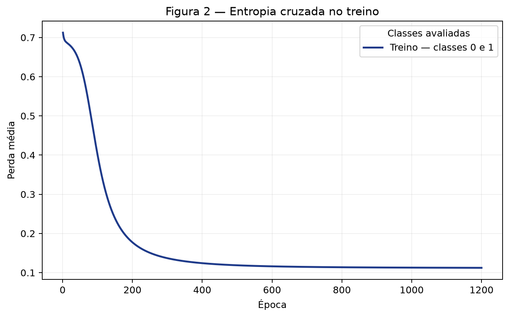
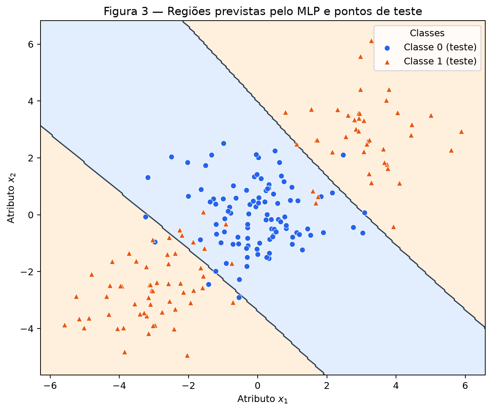
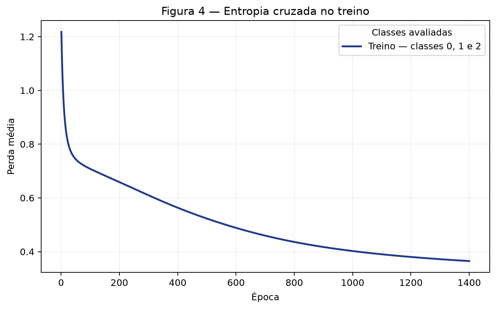
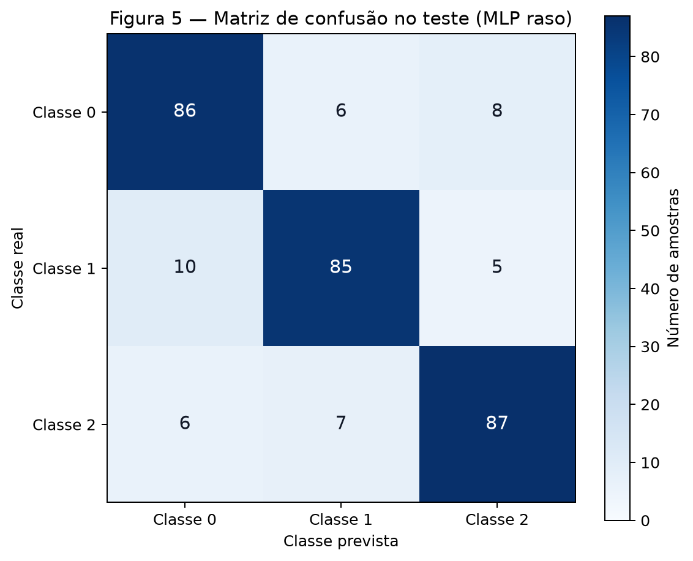
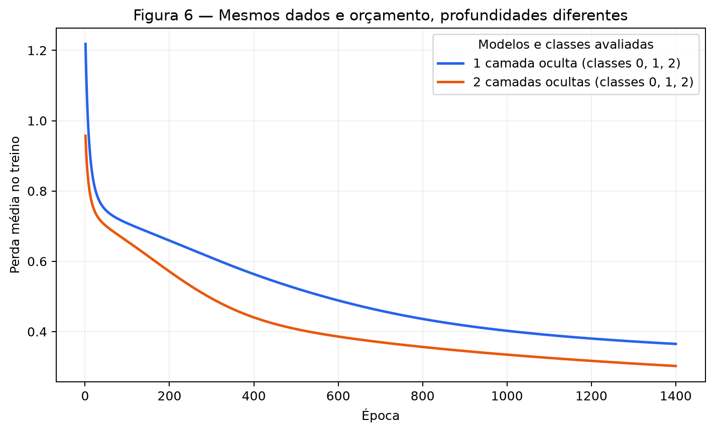

# 3. MLP

Esta atividade segue a pergunta do [enunciado](https://insper.github.io/ann-dl/2026.2/exercises/mlp/): o que uma camada oculta acrescenta, e quando uma segunda camada vale a pena? Primeiro faço um passo de retropropagação com os números escritos no relatório; depois uso **uma única implementação NumPy** para classificação binária, multiclasse e comparação de profundidade. Os resultados abaixo são os medidos, não metas de acurácia.

Para reproduzir a partir da raiz do repositório, instale `requirements.txt` e execute `python docs/exercises/mlp/code/mlp_exercise.py`. O script gera as seis figuras e [results.json](outputs/results.json). A implementação usa `rng = np.random.default_rng(42)` como gerador mestre; as três sementes da comparação são sorteadas desse gerador e registradas no arquivo de resultados. Os geradores do scikit-learn recebem `random_state=42`, como o enunciado exige. A padronização é calculada **somente no treino** e aplicada sem reajuste ao teste.

## Exercise 1

### A — Passagem direta

Com $\mathbf{x}=[0{,}5,-0{,}2]$, $y=1$, $\mathbf{W}^{(1)}=\begin{bmatrix}0{,}3&-0{,}1\\0{,}2&0{,}4\end{bmatrix}$, $\mathbf{b}^{(1)}=[0{,}1,-0{,}2]$, $\mathbf{W}^{(2)}=[0{,}5,-0{,}3]$ e $b^{(2)}=0{,}2$, a primeira camada calcula:

$$
\begin{aligned}
z^{(1)}_1&=0{,}3(0{,}5)+(-0{,}1)(-0{,}2)+0{,}1=0{,}2700000000,\\
z^{(1)}_2&=0{,}2(0{,}5)+0{,}4(-0{,}2)-0{,}2=-0{,}1800000000,\\
\mathbf{h}^{(1)}&=\tanh(\mathbf{z}^{(1)})
=[0{,}2636248355,\;-0{,}1780808681].
\end{aligned}
$$

A saída e a perda quadrática para esta única amostra ($N=1$) são:

$$
\begin{aligned}
u^{(2)}&=0{,}5(0{,}2636248355)-0{,}3(-0{,}1780808681)+0{,}2
=0{,}3852366782,\\
\hat y&=\tanh(u^{(2)})=0{,}3672465626,\\
L&=(y-\hat y)^2=(1-0{,}3672465626)^2=0{,}4003769125.
\end{aligned}
$$

### B — Passagem reversa

Pela regra da cadeia, começando na perda:

$$
\frac{\partial L}{\partial\hat y}
=-2(y-\hat y)=-1{,}2655068747,
\qquad
\frac{\partial\hat y}{\partial u^{(2)}}
=1-\hat y^2=0{,}8651299622.
$$

Assim, o erro local da saída e os gradientes de seus parâmetros são:

$$
\begin{aligned}
\delta^{(2)}
&=\frac{\partial L}{\partial u^{(2)}}
=\frac{\partial L}{\partial\hat y}
  \frac{\partial\hat y}{\partial u^{(2)}}
=-1{,}0948279147,\\
\frac{\partial L}{\partial\mathbf{W}^{(2)}}
&=\delta^{(2)}\mathbf{h}^{(1)}
=[-0{,}2886238289,\;0{,}1949679055],\\
\frac{\partial L}{\partial b^{(2)}}&=\delta^{(2)}=-1{,}0948279147.
\end{aligned}
$$

O sinal passa pelos pesos de saída antes de atravessar a derivada da `tanh` oculta:

$$
\begin{aligned}
\frac{\partial L}{\partial\mathbf{h}^{(1)}}
&=\delta^{(2)}\mathbf{W}^{(2)}
=[-0{,}5474139574,\;0{,}3284483744],\\
1-(\mathbf{h}^{(1)})^2
&=[0{,}9305019461,\;0{,}9682872044],\\
\delta^{(1)}
&=\frac{\partial L}{\partial\mathbf{z}^{(1)}}
=\frac{\partial L}{\partial\mathbf{h}^{(1)}}
 \odot[1-(\mathbf{h}^{(1)})^2]
=[-0{,}5093697527,\;0{,}3180323583].
\end{aligned}
$$

Portanto, cada linha do gradiente da matriz oculta é o erro local daquele neurônio multiplicado pela entrada $[0{,}5,-0{,}2]$:

$$
\begin{aligned}
\frac{\partial L}{\partial\mathbf{W}^{(1)}}
&=\delta^{(1)}\mathbf{x}^{\mathsf T}
=\begin{bmatrix}
-0{,}2546848763&0{,}1018739505\\
0{,}1590161791&-0{,}0636064717
\end{bmatrix},\\
\frac{\partial L}{\partial\mathbf{b}^{(1)}}
&=\delta^{(1)}
=[-0{,}5093697527,\;0{,}3180323583].
\end{aligned}
$$

### C — Atualização dos parâmetros

Aplico $\theta_{\mathrm{novo}}=\theta_{\mathrm{antigo}}-0{,}3\,\partial L/\partial\theta$ a **todos** os parâmetros, sem atualizar uma camada antes de terminar os gradientes da outra:

$$
\begin{aligned}
\mathbf{W}^{(1)}_{\mathrm{novo}}
&=\begin{bmatrix}
0{,}3764054629&-0{,}1305621852\\
0{,}1522951463&0{,}4190819415
\end{bmatrix},&
\mathbf{b}^{(1)}_{\mathrm{novo}}
&=[0{,}2528109258,\;-0{,}2954097075],\\
\mathbf{W}^{(2)}_{\mathrm{novo}}
&=[0{,}5865871487,\;-0{,}3584903716],&
b^{(2)}_{\mathrm{novo}}&=0{,}5284483744.
\end{aligned}
$$

**Nota de contagem:** a frase “oito parâmetros” do enunciado não bate com os valores fornecidos: são $4$ pesos ocultos $+2$ biases ocultos $+2$ pesos de saída $+1$ bias de saída, ou **nove escalares**. Os nove foram atualizados acima. Numa segunda passagem direta com esses valores, $\hat y=0{,}7111805295$ e $L=0{,}0834166865$, menor que $0{,}4003769125$. O passo levou a saída para mais perto de $y=1$; isso é um resultado deste passo, não uma promessa de que qualquer taxa de aprendizado sempre diminui a perda.

## Exercise 2

### A — Gere os dados

Segui exatamente `make_blobs(n_samples=[500,250,250], centers=[[0,0],[3,3],[-3,-3]], cluster_std=1.2, random_state=42)` e defini $y=(c>0)$. Assim, são 500 pontos da classe 0 no grupo central e 500 da classe 1 divididos entre os dois lados. A divisão estratificada `train_test_split(test_size=0.2, random_state=42, stratify=y)` produziu **800 treinos e 200 testes**, preservando 50% de cada classe em ambos.



### B — Estabeleça a linha de base

A regressão logística linear, ajustada apenas nos 800 exemplos de treino, acertou **47,50% (95/200)** no teste. Não usei esse estimador no MLP: ele serve apenas como comparação de uma única fronteira reta. Os mesmos parâmetros de padronização do treino foram aplicados ao teste para ambos os modelos.

### C — Implemente o MLP

O arquivo [mlp_from_scratch.py](code/mlp_from_scratch.py) recebe os tamanhos das camadas como argumento. Com lote de $N$ amostras e pesos armazenados como $(n_{\mathrm{entrada}},n_{\mathrm{saída}})$, cada camada oculta usa
$Z^{(l)}=A^{(l-1)}W^{(l)}+b^{(l)}$ e $A^{(l)}=\tanh(Z^{(l)})$.
Na saída binária, $p=\sigma(u)=1/(1+e^{-u})$ e
$L=-N^{-1}\sum[y\log p+(1-y)\log(1-p)]$.

A derivação do erro terminal não depende de uma biblioteca:

$$
\frac{\partial L}{\partial p}
=-\frac{y}{p}+\frac{1-y}{1-p},
\qquad
\frac{\partial p}{\partial u}=p(1-p)
\quad\Longrightarrow\quad
\frac{\partial L}{\partial u}=p-y.
$$

No lote, $\Delta^{(L)}=(P-Y)/N$. Para qualquer camada, o mesmo núcleo calcula
$\nabla W^{(l)}=(A^{(l-1)})^{\mathsf T}\Delta^{(l)}$,
$\nabla b^{(l)}=\sum_i\Delta_i^{(l)}$ e
$\Delta^{(l-1)}=[\Delta^{(l)}(W^{(l)})^{\mathsf T}]\odot[1-(A^{(l-1)})^2]$ para camadas ocultas. A atualização é $W\leftarrow W-\eta\nabla W$, $b\leftarrow b-\eta\nabla b$. Cada época faz uma atualização **full-batch**; a perda é medida logo após essa atualização. A inicialização Xavier e a escala calculada apenas no treino ajudam a evitar saturação inicial da `tanh`.

Usei arquitetura **2–12–1**, $\eta=0{,}25$ e **1.200 épocas**. A perda de treino caiu de **0,71235** após a primeira atualização para **0,11236** após a última (Figura 2), e a acurácia do MLP no teste foi **92,00% (184/200)**.



A Figura 3 avalia a rede em uma grade de coordenadas originais; a grade é transformada com a média e o desvio obtidos **somente no treino**. Os símbolos são os 200 pontos de teste, não os usados para ajustar os pesos.



??? abstract "Código executável: núcleo do MLP"

    ```python
    --8<-- "docs/exercises/mlp/code/mlp_from_scratch.py"
    ```

??? abstract "Código executável: dados, treino, métricas e figuras"

    ```python
    --8<-- "docs/exercises/mlp/code/mlp_exercise.py"
    ```

O arquivo [test_mlp.py](code/test_mlp.py) compara cada gradiente analítico com diferenças finitas em redes binária, multiclasse rasa e multiclasse profunda; os três testes passaram. Ele é uma verificação, não substitui as derivadas apresentadas aqui.

### D — Análise

Na Figura 3, a rede atribui **classe 0 a uma faixa central diagonal** e **classe 1 às duas regiões externas**, uma em cada lado. Uma única desigualdade linear produz apenas um semiplano: se escolher um lado como classe 1, deixa de fora o grupo oposto; se tentar cobrir os dois, atravessa a classe 0 central. A simetria aproximada dos dois grupos externos ainda tende a cancelar a orientação de uma regressão logística linear, que nesta partição ficou em 47,50%. As ativações `tanh` compõem várias transições lineares e permitem a faixa central entre duas fronteiras; por isso o MLP chegou a 92,00%, **44,50 pontos percentuais** acima da linha de base.

## Exercise 3

### A — Gere os dados

Usei `make_classification(n_samples=1500, n_features=4, n_informative=4, n_redundant=0, n_repeated=0, n_classes=3, n_clusters_per_class=2, class_sep=1.0, random_state=42)`, sem mudar parâmetros. As classes ficaram com **499, 499 e 502** amostras. A divisão 80/20 estratificada e com `random_state=42` deu **1.200 treinos e 300 testes**. A mesma matriz de treino/teste padronizada é usada também no Exercício 4.

### B — Adapte a rede

Mudei apenas argumentos do mesmo objeto `MLP`: saída com **3 unidades** e `output_mode="multiclass"`. A função de saída agora é $p_j=e^{u_j}/\sum_k e^{u_k}$, calculada após subtrair $\max_k u_k$ por estabilidade numérica, e a perda é $L=-\sum_k y_k\log p_k$ por amostra, com $Y$ one-hot. A passagem direta genérica, a reversa pelas camadas e a atualização no código **não foram copiadas nem alteradas**; são as mesmas funções usadas no Exercício 2.

Para mostrar por que o delta terminal continua igual, a derivada da softmax é
$\partial p_k/\partial u_j=p_k(\mathbf{1}_{k=j}-p_j)$. Aplicando a regra da cadeia à entropia cruzada:

$$
\begin{aligned}
\frac{\partial L}{\partial u_j}
&=-\sum_k\frac{y_k}{p_k}
  \frac{\partial p_k}{\partial u_j}\\
&=-\sum_k y_k(\mathbf{1}_{k=j}-p_j)
=-y_j+p_j\sum_k y_k
=p_j-y_j,
\end{aligned}
$$

porque $\sum_k y_k=1$. Para o lote de $N$ amostras, resulta
$\Delta^{(L)}=(P-Y)/N$, a mesma expressão que o método `backward` recebe no caso binário. Só muda a criação das probabilidades, dos alvos e da perda.

### C — Treine e avalie

Na primeira semente da comparação (`1988314614`), usei **4–16–3**, `tanh` oculta, gradiente descendente full-batch, $\eta=0{,}12$ e **1.400 épocas**. A perda final de treino foi **0,36495** e a acurácia no teste foi **86,00% (258/300)**. A Figura 4 mostra a curva de treino; a Figura 5 mostra todas as 300 classificações de teste, com classe real nas linhas e classe prevista nas colunas.





### D — Análise

O par mais confundido na Figura 5 foi **0–1**, com **16 erros nos dois sentidos**: 6 exemplos reais da classe 0 previstos como 1 e 10 da classe 1 previstos como 0. Os outros pares tiveram 14 (0–2) e 12 (1–2); a diferença é pequena, então não atribuo a causa a um grupo específico que o gerador não identifica no relatório. Como as **quatro dimensões são informativas** e cada classe reúne **dois grupos**, uma classe não precisa ocupar uma única região simples no espaço 4D; grupos de classes distintas podem se aproximar e exigir fronteiras curvas. Essa estrutura é compatível com os erros fora da diagonal. A regressão logística linear obteve **66,33% (199/300)** no mesmo teste; a camada oculta acrescentou capacidade para compor fronteiras não lineares e elevou o resultado da primeira semente a **86,00%**, ganho de **19,67 pontos percentuais**.

## Exercise 4

### A — Treine a rede mais profunda

Troquei apenas a profundidade, de **4–16–3** para **4–16–16–3**: mesma largura oculta de 16, mesmos dados e pré-processamento, mesma semente de cada par, $\eta=0{,}12$, full-batch e **1.400 épocas**. Na primeira semente, a rede profunda teve acurácia de **85,33% (256/300)**, contra 86,00% da rasa. A primeira matriz de pesos das duas redes de cada par parte dos mesmos sorteios; a camada adicional explica a diferença estrutural e o aumento de parâmetros.

### B — Compare

A Figura 6 compara as perdas de treino **da primeira semente** nos mesmos eixos. Para não interpretar uma inicialização isolada como propriedade da arquitetura, repeti a comparação com as três sementes derivadas do gerador mestre:

| Semente | Rasa: perda final | Rasa: teste | Profunda: perda final | Profunda: teste |
|---:|---:|---:|---:|---:|
| 1988314614 | 0,36495 | 86,00% | 0,30222 | 85,33% |
| 558008616 | 0,37544 | 84,00% | 0,29906 | 86,00% |
| 2948401465 | 0,36990 | 85,00% | 0,30918 | 83,67% |

| Modelo | Camadas ocultas | Parâmetros | Perda final de treino (média) | Acurácia no teste (média) |
|---|---:|---:|---:|---:|
| Exercício 3 — 4–16–3 | 1 | 131 | 0,37010 | 85,00% |
| Exercício 4 — 4–16–16–3 | 2 | 403 | 0,30349 | 85,00% |

Assim, a diferença **profunda menos rasa foi 0,00 ponto percentual** na média de três sementes. A rede mais profunda ajustou melhor o treino, mas não apresentou ganho médio no teste.



### C — Análise

Há apenas **seis grupos geradores em quatro dimensões informativas**, e uma camada de 16 unidades já encontrou fronteiras úteis: 85,00% de acurácia média. A segunda camada pode compor representações mais elaboradas, mas elevou a contagem de **131 para 403 parâmetros** e sua otimização passa por mais uma transformação não linear. Aqui a perda média de treino caiu de **0,37010 para 0,30349**, enquanto a acurácia média de teste permaneceu **85,00%**. Logo, a capacidade adicional foi usada para ajustar o treino sem benefício médio de generalização nesta comparação; uma semente favoreceu a profunda, duas favoreceram a rasa. Não aumentei o orçamento nem selecionei a semente vencedora. Profundidade extra seria mais promissora para padrões composicionais ou hierárquicos, nos quais uma primeira camada aprende partes locais e outra precisa combiná-las — por exemplo, estruturas visuais com componentes reutilizáveis —, não necessariamente para estes poucos grupos tabulares.

## Results summary

| # | Quantidade | Valor |
|---:|---|---|
| 1 | Ex. 1 — $\mathbf{z}^{(1)}$ e $\mathbf{h}^{(1)}$ | $[0{,}2700000000,-0{,}1800000000]$; $[0{,}2636248355,-0{,}1780808681]$ |
| 2 | Ex. 1 — $u^{(2)}$, $\hat y$ e $L$ | $0{,}3852366782$; $0{,}3672465626$; $0{,}4003769125$ |
| 3 | Ex. 1 — parâmetros atualizados (9 escalares fornecidos) | $W^{(1)}=\begin{bmatrix}0{,}3764054629&-0{,}1305621852\\0{,}1522951463&0{,}4190819415\end{bmatrix}$; $b^{(1)}=[0{,}2528109258,-0{,}2954097075]$; $W^{(2)}=[0{,}5865871487,-0{,}3584903716]$; $b^{(2)}=0{,}5284483744$ |
| 4 | Ex. 2 — acurácia da linha de base linear | 47,50% (95/200) |
| 5 | Ex. 2 — arquitetura e acurácia no teste | 2–12–1; 92,00% (184/200) |
| 6 | Ex. 3 — arquitetura e acurácia no teste | 4–16–3; 86,00% (258/300) na primeira semente; 85,00% de média em três |
| 7 | Ex. 3 — par de classes mais confundido | 0–1: 16 erros (6 de 0→1; 10 de 1→0) |
| 8 | Ex. 4 — arquitetura e acurácia no teste | 4–16–16–3; 85,33% (256/300) na primeira semente; 85,00% de média em três |
| 9 | Ex. 4 — diferença de acurácia para Ex. 3 (média de 3 sementes) | 85,00% − 85,00% = **0,00 ponto percentual** |
