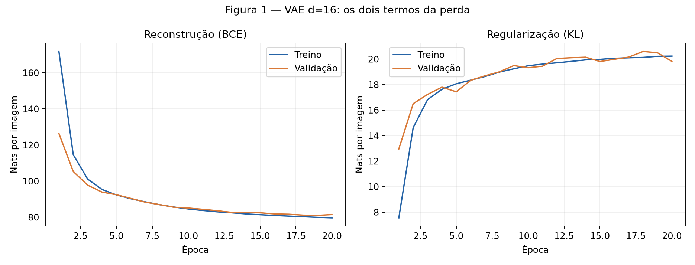
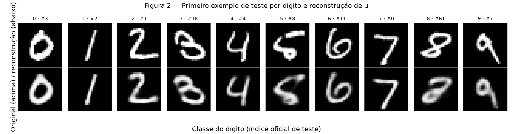
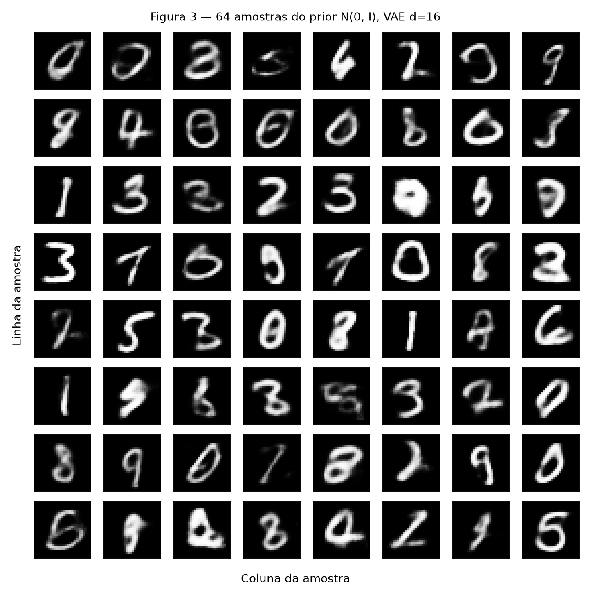
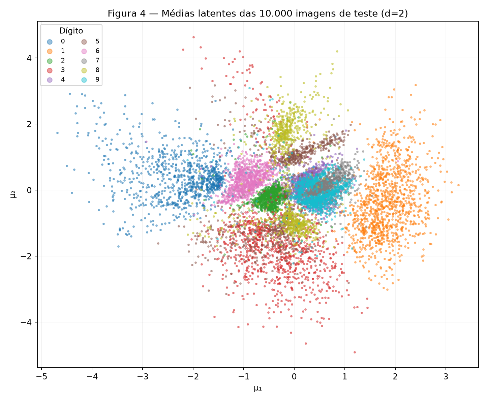
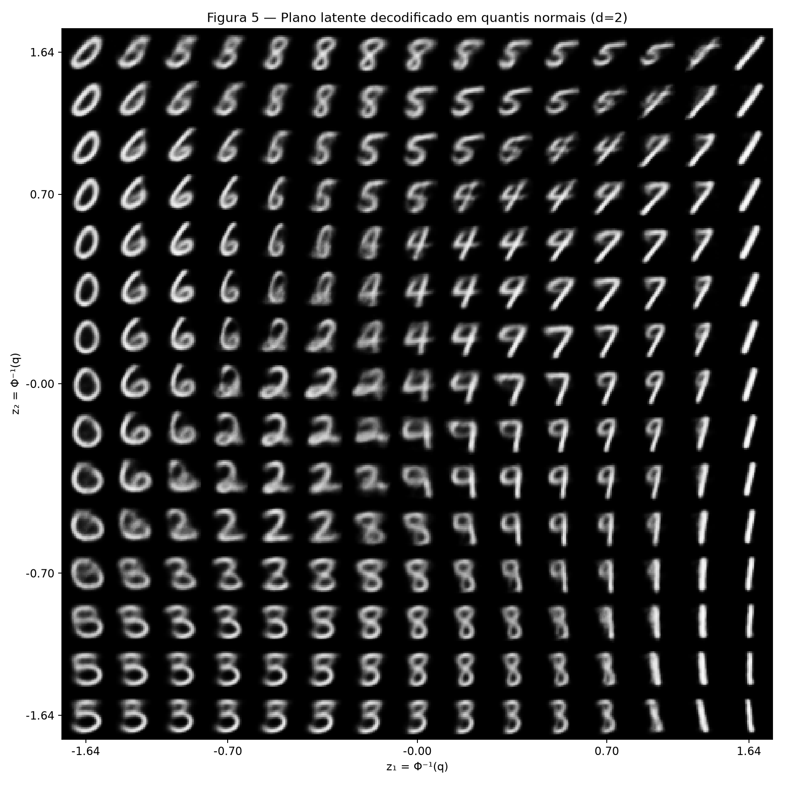
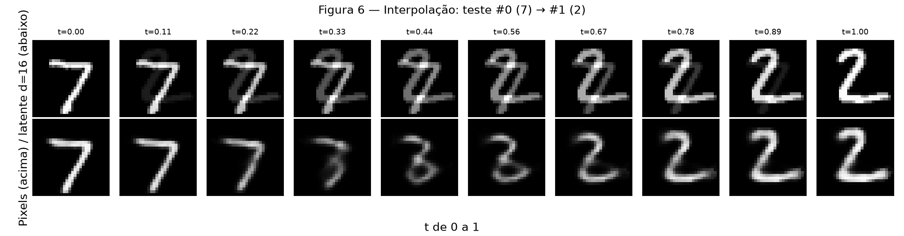

# 4. VAE — reconstrução e regularização do espaço latente

Este relatório responde ao [enunciado da atividade](https://insper.github.io/ann-dl/pt/2026.2/exercises/vae/). O objetivo é observar separadamente os dois custos do VAE: reconstruir a imagem e aproximar a distribuição latente de $\mathcal N(0,I)$. Os dois modelos usam o mesmo código e diferem apenas na dimensão latente. As figuras, os [históricos por época](outputs/history_d16.csv) e os [resultados numéricos](outputs/results.json) estão versionados; a aparência das imagens é analisada sem tratá-la como métrica objetiva.

Para reproduzir de um clone limpo, instale `requirements.txt` e [requirements-vae.txt](code/requirements-vae.txt), depois execute `python docs/exercises/vae/code/test_vae.py` e `python docs/exercises/vae/code/vae_exercise.py` na raiz do repositório. O MNIST é baixado automaticamente para `data/`, que não é versionada. A implementação usa CPU, lote 128, 20 épocas, Adam $10^{-3}$, $\beta=1$, `torch.manual_seed(42)` antes de construir **cada** modelo e o gerador de divisão exigido. O arquivo [vae_exercise.py](code/vae_exercise.py) contém o código-fonte executado, não só trechos para leitura.

## Exercício 1

### A — Carregue e divida os dados

Usei `torchvision.datasets.MNIST("data", ..., transform=transforms.ToTensor())`, que fornece pixels em $[0,1]$. Cada tensor $1\times28\times28$ é achatado em 784 valores no laço de treino. A divisão de `train_full` foi `random_split(train_full, [50_000, 10_000], generator=torch.Generator().manual_seed(42))`: **50.000** imagens de treino e **10.000** de validação. As **10.000** imagens oficiais de teste não participam de ajustes, seleção de hiperparâmetros nem inspeção durante o treino; são avaliadas numericamente somente depois da 20ª época de cada modelo. As figuras de teste vêm após essa avaliação.

### B — Construa o modelo

O encoder é $784\to512\to256$ com ReLU depois das duas camadas. Duas cabeças lineares independentes $256\to d$ produzem $\boldsymbol\mu$ e $\log\boldsymbol\sigma^2$. O decoder é $d\to256\to512\to784$, ReLU nas ocultas e sigmoide na saída. Neste primeiro modelo, $d=16$.

A amostragem diferenciável é escrita explicitamente:

$$
\boldsymbol\epsilon\sim\mathcal N(0,I),\qquad
\mathbf z=\boldsymbol\mu+\exp\!\left(\tfrac12\log\boldsymbol\sigma^2\right)\odot\boldsymbol\epsilon.
$$

Para um lote com $B$ imagens, cada termo é **somado nas dimensões e dividido somente por $B$**, em nats por imagem:

$$
\begin{aligned}
L_{\mathrm{rec}}&=\frac{1}{B}\sum_{n=1}^B\sum_{j=1}^{784}-\big[x_{nj}\log\hat x_{nj}+(1-x_{nj})\log(1-\hat x_{nj})\big],\\
L_{\mathrm{KL}}&=\frac{1}{2B}\sum_{n=1}^B\sum_{i=1}^{d}\big[\mu_{ni}^2+\exp(\log\sigma_{ni}^2)-1-\log\sigma_{ni}^2\big],\\
L&=L_{\mathrm{rec}}+\beta L_{\mathrm{KL}},\qquad\beta=1.
\end{aligned}
$$

O código usa `F.binary_cross_entropy(..., reduction="sum") / B`, a KL fechada acima e a soma. Não usa VAE pronto nem `torch.distributions.kl_divergence`. A BCE corresponde a uma verossimilhança Bernoulli para cada pixel; o erro quadrático da aula corresponde a uma hipótese gaussiana. `reduction="mean"` também dividiria por 784, mudando indevidamente a escala relativa entre reconstrução e KL.

### C — Treine

Treinei com Adam, taxa **$10^{-3}$**, lotes de **128** e **20 épocas**, sem interrupção antecipada. Em cada época registrei reconstrução e KL no treino e na validação, ponderando pelo tamanho real de cada lote (inclusive o último). O conjunto de validação informa a evolução; o teste só fornece a avaliação final. A avaliação numérica mantém a amostragem de $q_\phi(z\mid x)$ e fixa a semente de teste em 42.

| Conjunto / época | Reconstrução (nats/imagem) | KL (nats/imagem) | ELBO negativo (nats/imagem) |
|---|---:|---:|---:|
| Validação, época 1 | 126,40 | 12,96 | 139,36 |
| Validação, época 20 | 81,47 | 19,83 | 101,29 |
| Teste final, $d=16$ | 80,93 | 19,87 | 100,80 |



**Figura 1.** Na validação, a BCE cai **44,93 nats/imagem** entre as épocas 1 e 20 (126,40 para 81,47), enquanto a KL sobe **6,87** (12,96 para 19,83). Assim, a soma ainda cai **38,07** (139,36 para 101,29). As curvas de treino e validação permanecem próximas ao final; a pequena oscilação da validação não autoriza concluir que cada época melhorou.

### D — Reconstruções e amostras

A Figura 2 usa o **primeiro índice oficial de teste** de cada dígito, com original na linha superior e reconstrução na inferior. Decodifiquei $\boldsymbol\mu$, sem sorteio de $z$, para isolar a reconstrução determinística de cada entrada.



A Figura 3 contém **64** imagens de $z\sim\mathcal N(0,I_{16})$ numa grade $8\times8$; a amostra é sorteada imediatamente depois de `torch.manual_seed(0)`.



### E — Análise

Na Figura 1, a KL de validação sobe de **12,96 para 19,83 nats/imagem**, enquanto a BCE cai de **126,40 para 81,47**. O otimizador aceita pagar mais KL quando o posterior passa a carregar mais informação específica sobre a imagem e a redução da BCE é maior que o aumento da KL; o objetivo é minimizar **a soma**, não cada parcela isoladamente. Isso não torna a KL dispensável: ela evita que as distribuições codificadas se afastem demais do prior.

As amostras livres da Figura 3 podem ser mais borradas ou menos reconhecíveis por **dois motivos distintos**. Primeiro, mesmo com penalidade KL, regiões sorteadas de $\mathcal N(0,I)$ podem ser pouco cobertas pelos códigos efetivos das imagens; o decoder extrapola nessas regiões. Segundo, com verossimilhança Bernoulli fatorada e BCE, a saída sigmoide representa probabilidades médias condicionais dos pixels: quando diferentes traços são plausíveis para o mesmo $z$, a média produz cinzas e bordas borradas. Já a Figura 2 usa $\mu(x)$ de imagens reais, em regiões informadas pelo encoder. Decodificar $\mu$, em vez de sortear $z\sim q(z\mid x)$, remove o ruído de amostragem, permitindo comparar original e reconstrução de forma estável.

## Exercício 2

### A — Treine um VAE 2-D

Reiniciei `torch.manual_seed(42)` antes de construir o segundo VAE. Mantive **a mesma arquitetura fora do gargalo, os mesmos 50.000/10.000/10.000 exemplos, $\beta=1$, Adam $10^{-3}$, lote 128 e 20 épocas**; a única mudança estrutural foi $d=16\to d=2$. A ordem de lotes também parte do mesmo gerador 42. Não ajustei parâmetros para forçar um resultado visual melhor.

| Dimensão latente | Reconstrução no teste | KL no teste | ELBO negativo no teste |
|---:|---:|---:|---:|
| $d=16$ | 80,93 | 19,87 | 100,80 |
| $d=2$ | 135,83 | 6,79 | 142,62 |

O gargalo 2-D eleva a reconstrução em **54,89 nats/imagem** e reduz a KL em **13,08**; o ELBO negativo fica **41,82** maior. Os [históricos do segundo modelo](outputs/history_d2.csv) permitem conferir a mesma contabilidade por época.

### B — O conjunto de teste codificado

A Figura 4 apresenta as **10.000 médias $\boldsymbol\mu$** do encoder 2-D, uma cor para cada dígito e legenda de classes. Trata-se dos parâmetros do posterior, não de uma amostra aleatória de $z$.



**Figura 4.** Há regiões relativamente isoladas, como a nuvem de **1** à direita ($\mu_1\gtrsim1$) e a de **0** à esquerda ($\mu_1\lesssim-1{,}5$). Em contraste, **4, 9 e 7** se misturam perto de $\mu_1\in[0,1]$ e $\mu_2\in[-0{,}5,0{,}8]$; esses intervalos são leitura visual aproximada, não limites de classes.

### C — O plano decodificado

Para a Figura 5, usei 15 quantis $q\in[0{,}05,0{,}95]$ igualmente espaçados em cada eixo e $z=\Phi^{-1}(q)$, com `scipy.stats.norm.ppf`. Decodifiquei os **225** pares no arranjo do plano, com $z_1$ na horizontal e $z_2$ na vertical. Incrementos iguais em $q$ delimitam intervalos de **igual massa da normal** na região central, ao contrário de intervalos de mesmo comprimento em $z$, que concentrariam mais massa perto de zero; as caudas além de 5% e 95% não estão na grade.



### D — Interpolação

Escolhi as imagens oficiais de teste de índices **0** e **1** (dígitos **7** e **2**, respectivamente). Para dez valores igualmente espaçados de $t\in[0,1]$, a linha de cima é $(1-t)x_0+tx_1$ nos pixels; a linha inferior é $\mathrm{decode}((1-t)\mu_0+t\mu_1)$ no **modelo de $d=16$**, não no de $d=2$.



### E — Análise

Na Figura 4, **4, 9 e 7** se sobrepõem perto de $\mu_1\in[0,1]$, $\mu_2\in[-0{,}5,0{,}8]$. Na região correspondente da Figura 5, ao caminhar horizontalmente próximo de $z_2=0$, as imagens passam de um **4** de topo aberto para formas parecidas com **9** e depois **7**; algumas têm o fechamento e a haste simultaneamente, sem classe inequívoca. A continuidade mostra formas intermediárias, mas não prova que toda amostra intermediária seja um dígito válido.

O gargalo de **dois números** não consegue preservar simultaneamente identidade, estilo de escrita, posição, espessura, inclinação e detalhes de cada traço de todas as imagens. Na Figura 5, dígitos de uma mesma região se parecem com **protótipos suavizados**, e os limites entre 4, 9 e 7 exibem traços mistos ou borrados. Isso é coerente com a BCE de teste **135,83**, contra **80,93** no modelo de 16 dimensões, que dispõe de mais capacidade para variações intra-classe.

Na Figura 6, a linha de pixels conserva simultaneamente a barra superior do **7** e a curva/base do **2** entre aproximadamente $t=0{,}22$ e $0{,}78$; os meios parecem transparências sobrepostas, não dígitos únicos. A linha latente arredonda e desloca os traços: passa por formas intermediárias próximas de **3/2** e termina num 2 reconhecível. A mistura direta de pixels não tem regra para transformar traços; a interpolação latente passa por códigos que o decoder aprendeu a mapear para imagens, embora nem todo ponto seja perfeitamente plausível.

??? example "Código completo — modelo, perda, treino e figuras"

    ```python
    --8<-- "docs/exercises/vae/code/vae_exercise.py"
    ```

## Resumo dos resultados

| # | Quantidade | Valor |
|---:|---|---|
| 1 | Ex. 1 — reconstrução, KL e ELBO negativo no teste ($d=16$) | **80,93; 19,87; 100,80 nats/imagem** |
| 2 | Ex. 1 — KL de validação na primeira e na última época | **12,96; 19,83 nats/imagem** |
| 3 | Ex. 2 — reconstrução e KL no teste ($d=2$) | **135,83; 6,79 nats/imagem** |
| 4 | Ex. 2 — os dois índices de teste interpolados | **0 e 1** |
